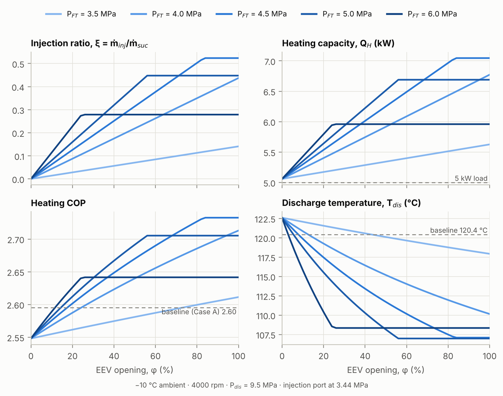
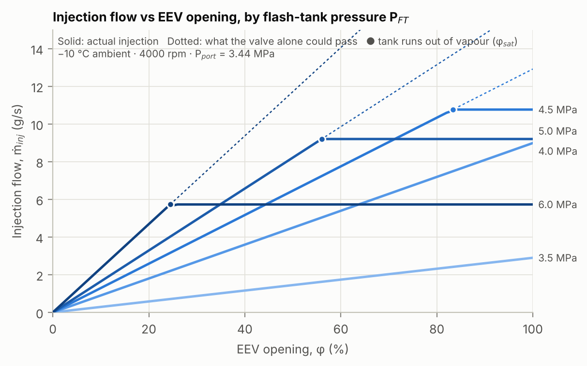
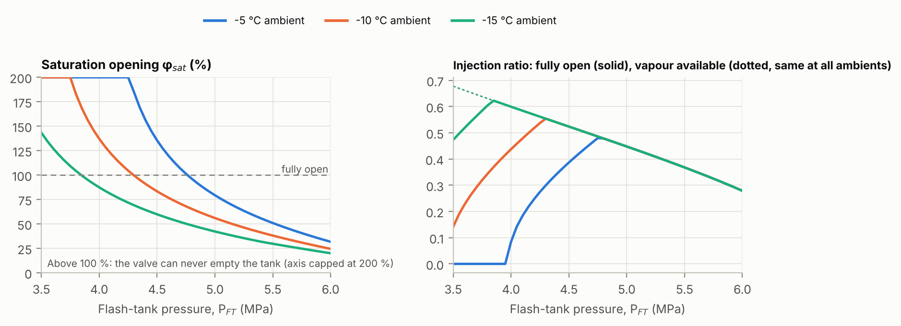
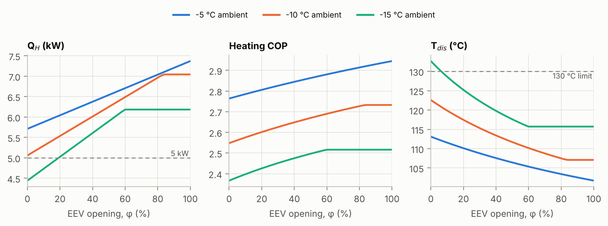
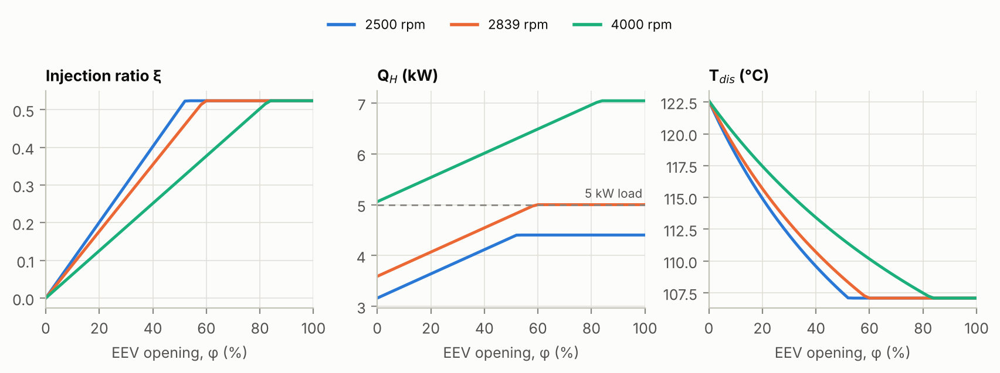
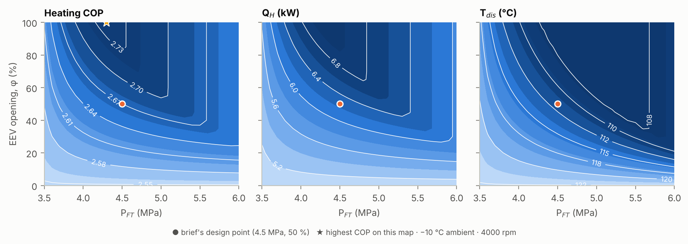
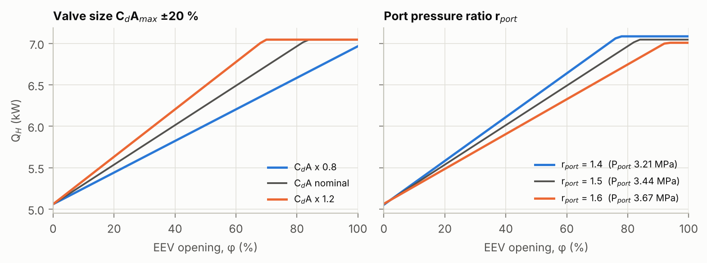
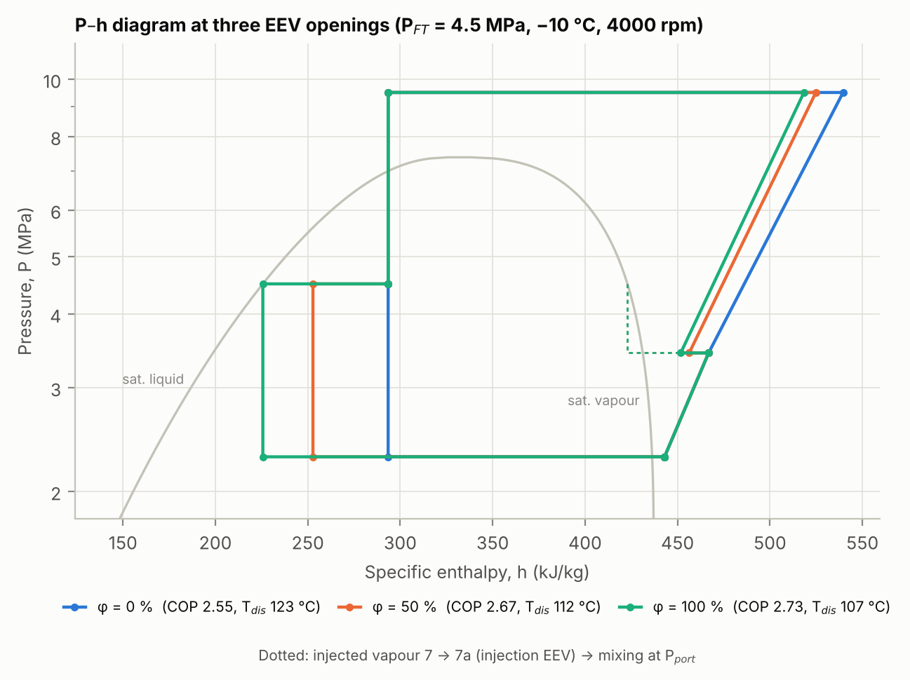

# FT-VI Heat Pump: Task 3 (Injection EEV and Flow Control)

This repo adds an injection electronic expansion valve (EEV) model to a flash-tank vapour-injection (FT-VI) R744 (CO₂) heat pump for electric-vehicle cabin heating in cold weather. It is Task 3 (Student 3) of the group project *Vapor Injection Heat Pump Optimization for Electric Vehicle Cold Weather Performance*.

The model builds on the Students 1–2 baseline and flash-tank code from [durgeshnimse/Vapor-Injection-Heat-Pump-Optimization-for-Electric-Vehicle-Cold-Weather-Performance](https://github.com/durgeshnimse/Vapor-Injection-Heat-Pump-Optimization-for-Electric-Vehicle-Cold-Weather-Performance). Those files are included here unchanged, under their MIT licence.

## Key results

These figures are at −10 °C ambient, 4000 rpm, 4.5 MPa flash-tank pressure and 9.5 MPa discharge pressure.

| | Baseline (Case A) | EEV 50 % | EEV fully open |
|---|---|---|---|
| Heating capacity | 5.00 kW | 6.25 kW (+25 %) | 7.05 kW |
| Heating COP | 2.595 | 2.670 (+2.9 %) | 2.733 |
| Discharge temperature | 120.4 °C | 111.7 °C | 107.1 °C |
| Injection ratio ṁ<sub>inj</sub>/ṁ<sub>suc</sub> | – | 0.314 | 0.524 |

- **Opening the EEV improves all three objectives together.** Injection raises COP and heating capacity and lowers discharge temperature.
- **Past the saturation opening φ<sub>sat</sub>, opening further does nothing.** At φ<sub>sat</sub> the tank has no vapour left to inject. It is 83 % at the design point and 25 % at 6.0 MPa.
- **Best tank pressure.** COP and capacity both peak at about 4.3 MPa, the pressure at which the fully open valve just empties the tank (COP 2.743, 7.19 kW).
- **At −15 °C the EEV is needed to meet the constraints.** With the valve closed, the cycle fails both the 130 °C and the 5 kW limits. About 20 % opening satisfies both.



## Model

The valve sits on the vapour line between the flash tank (saturated vapour at P<sub>FT</sub>) and the compressor injection port (P<sub>port</sub>).

| Relation | Equation |
|---|---|
| Port pressure | P<sub>port</sub> = r<sub>port</sub> · P<sub>evap</sub>, with r<sub>port</sub> = 1.5 |
| Valve flow (compressible orifice, choke-limited) | ṁ<sub>valve</sub> = C<sub>d</sub> · φ · A<sub>max</sub> · Y · √(2 ρ<sub>v</sub> ΔP), where Y = 1 − 0.41 ΔP / (k P<sub>FT</sub>) and ΔP = min[P<sub>FT</sub> − P<sub>port</sub>, (1 − r<sub>crit</sub>) P<sub>FT</sub>] |
| Vapour cap (no liquid injection) | ṁ<sub>inj</sub> = min[ṁ<sub>valve</sub>, x/(1 − x) · ṁ<sub>suc</sub>] |
| Vapour the valve does not pass goes to EEV-2 | h<sub>8</sub> = h<sub>5</sub> + ξ (h<sub>5</sub> − h<sub>7</sub>), with ξ = ṁ<sub>inj</sub>/ṁ<sub>suc</sub> |
| Valve size | Fully open passes 1.2 × the available vapour at the design point, giving C<sub>d</sub>A<sub>max</sub> = 0.823 mm² (≈ 1.2 mm orifice at C<sub>d</sub> = 0.70) |
| Compressor | Two stages split at P<sub>port</sub>, η<sub>is</sub> = 0.70 each, with adiabatic mixing of the injected vapour |

All Task 3 assumptions are in the `EEV` dict at the top of `eev.py`.

### Validation

- **Ideal-port limit.** With P<sub>port</sub> → P<sub>FT</sub> and an unlimited valve, the model reproduces Student 2's `ftvi()` to a relative difference of 10⁻⁸.
- **Balances.** Energy balances close to about 10⁻¹⁵ kW, and the flash-tank residual is zero.
- **Stage-2 inlet.** The mixed state entering stage 2 is superheated by at least 18 kJ/kg over the whole operating range.

## Files

| File | Author | Purpose |
|---|---|---|
| `eev.py` | Student 3 | Valve model, port pressure, `m_inj()` hand-over function, saturation opening |
| `ftvi_eev.py` | Student 3 | `ftvi_eev()` cycle with EEV control; swappable `compressor()` for Student 4 |
| `run_task3.py` | Student 3 | All Task 3 studies: CSVs, figures and the hand-over JSON |
| `config.py`, `co2_props.py`, `baseline_cycle.py`, `flash_tank_vi.py` | Students 1–2 | Brief data, CO₂ properties, baseline and FT-VI cycles (unchanged) |
| `results_task3/` | | Sweep CSVs, state table, validation, `T3_handover_student5.json` |
| `figures_task3/` | | Figures 1–8 |

## Run

```bash
pip install -r requirements.txt
python run_task3.py        # ~10 s; writes results_task3/ and figures_task3/
python ftvi_eev.py         # quick design-point printout
```

Use CoolProp (the Span–Wagner reference equation) for report numbers. Without it, the code falls back to a Peng–Robinson model, which gives noticeably different values near the critical point.

## For Student 5 (integration)

```python
import eev, ftvi_eev as fe
r = fe.ftvi_eev(phi=0.5, P_FT=4.5, T_evap=-15.0, N=4000)   # MPa, degC, rpm; phi 0..1
r["Q_h"], r["W"], r["COP_h"], r["T_dis"], r["xi"]
```

Test cases to check against are in `results_task3/T3_handover_testcases.csv`.

## For Student 4 (compressor)

Replace `ftvi_eev.compressor()`, keeping its signature and return keys, then re-run `run_task3.py`. Every result updates.

## Figures

| | |
|---|---|
|  |  |
|  |  |
|  |  |


